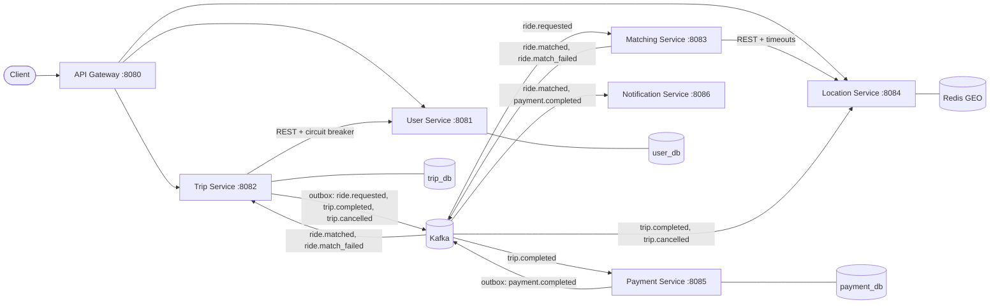

# RideFlow

A real-time ride-hailing backend built as event-driven microservices. A rider requests a trip, the system finds the nearest free driver, tracks the trip through its lifecycle, charges the fare, and notifies both sides, with services communicating mostly through Kafka events.

**Stack:** Java, Spring Boot, Apache Kafka, Redis (GEO), PostgreSQL, Spring Cloud Gateway, Resilience4j, Docker Compose.

The goal of the project is to practise distributed-systems problems end to end: reliable event publishing, idempotent consumers, preventing double-booking under concurrency, and failure handling.

## Architecture



Each service owns its own data. No service reads another service's database.

## Services

| Service | Port | Responsibility | Data store |
|---|---|---|---|
| api-gateway | 8080 | Single entry point, routes by path | none |
| user-service | 8081 | Rider and driver profiles | PostgreSQL `user_db` |
| trip-service | 8082 | Trip state machine, transactional outbox | PostgreSQL `trip_db` |
| matching-service | 8083 | Picks the nearest free driver for each ride request | none |
| location-service | 8084 | Driver positions (Redis GEO), atomic driver reservation and release | Redis |
| payment-service | 8085 | Fare calculation, idempotent payments, outbox | PostgreSQL `payment_db` |
| notification-service | 8086 | Reacts to events and logs notifications | none |

## Events

| Topic | Produced by | Consumed by |
|---|---|---|
| `ride.requested` | trip-service | matching-service |
| `ride.matched` | matching-service | trip-service, notification-service |
| `ride.match_failed` | matching-service | trip-service |
| `trip.completed` | trip-service | payment-service, location-service |
| `trip.cancelled` | trip-service | location-service |
| `payment.completed` | payment-service | notification-service |
| `ride.requested.DLT` | matching-service error handler | (parked for inspection) |

Topics are created automatically with 3 partitions. Events for one trip use the trip id as the key, so they stay ordered within a partition.

## Key design decisions

- **Event-driven flow.** Requesting a trip only saves a row and returns. Matching, payment and notifications happen asynchronously, so a slow or restarting downstream service never blocks the rider's request.
- **Transactional outbox** (trip-service, payment-service). The business row and the event are written in one database transaction. A scheduled publisher then sends unpublished rows to Kafka. This removes the "saved to the database but the event was lost" failure. Delivery is at-least-once.
- **Idempotent consumers.** Duplicate delivery is expected, so every state-changing consumer checks before acting: trip transitions only apply from the expected state, payments are unique per trip (check plus a unique constraint), and driver reservation is safe to repeat for the same trip.
- **No double-booking.** A driver is reserved with a Redis `SET key value NX` plus expiry, which is a single atomic operation. The reservation lasts until the trip completes or is cancelled (released by events), with a 2-hour expiry as a safety net.
- **Trip lifecycle as a state machine.** Allowed transitions are defined once in the `Status` enum, and illegal moves return 409.
- **Resilience.** Trip-service calls user-service with timeouts and a circuit breaker. Matching-service calls use timeouts, and failed messages are retried with exponential backoff and then parked in a dead-letter topic instead of being dropped.
- **Failure is an event.** When no driver can be found, matching publishes `ride.match_failed` with a reason (`NO_DRIVERS_NEARBY` or `ALL_DRIVERS_BUSY`) and the trip moves to `NO_DRIVERS_AVAILABLE`.

## Run it

Requirements: Docker Desktop with about 6 GB of memory available.

```
git clone <your-repo-url>
cd rideflow
docker compose up -d --build
```

The first build takes several minutes. Check that all 10 containers are running with `docker ps`.

Seed some data (use `curl.exe` in Windows PowerShell, or Postman). On a fresh database the first user gets id 1 and the second gets id 2.

```
curl -X POST http://localhost:8080/users -H "Content-Type: application/json" -d '{"name":"Rider","email":"rider@test.com","role":"RIDER"}'
curl -X POST http://localhost:8080/users -H "Content-Type: application/json" -d '{"name":"Driver","email":"driver@test.com","role":"DRIVER"}'
curl -X POST http://localhost:8080/drivers/2/location -H "Content-Type: application/json" -d '{"lat":12.9716,"lng":77.5946}'
```

Request a trip and follow it:

```
curl -X POST http://localhost:8080/trips -H "Content-Type: application/json" -d '{"riderId":1,"pickupLat":12.9716,"pickupLng":77.5946,"dropLat":12.9352,"dropLng":77.6245}'
curl http://localhost:8080/trips/1
curl -X POST http://localhost:8080/trips/1/arriving
curl -X POST http://localhost:8080/trips/1/start
curl -X POST http://localhost:8080/trips/1/complete
docker logs rideflow-notification-service --tail 5
```

Other endpoints: `POST /trips/{id}/cancel`, `GET /drivers/nearby?lat=..&lng=..&radiusKm=..`, `GET /users/{id}`.

To wipe all data and start clean: `docker compose down -v`.

## Measured results

All numbers were measured on a single laptop with every service, the databases, Kafka, and the load generator (k6) running on the same machine. Treat them as a relative baseline, not production capacity.

**Baseline, `POST /trips` through the gateway**

- 10 virtual users for 30 seconds
- 3,151 requests, 0% failed
- Median 76 ms, p95 180 ms, about 105 requests per second
- Afterwards: 0 unpublished outbox rows, and the outbox row count matched the number of trips plus completion events

The 76 ms covers only the synchronous part (gateway, rider check, one database transaction). Matching and payment happen afterwards through Kafka.

**Concurrency check, driver reservation**

- 100 trip requests from 20 parallel users against exactly 5 free drivers at the same location, with the matching service running 3 consumer threads
- Result: exactly 5 trips `MATCHED`, 95 `NO_DRIVERS_AVAILABLE`, and each driver assigned exactly once
- Matches were logged in the same millisecond on different threads, so the requests really did race
- p95 latency was 392 ms at this higher concurrency

Load test scripts are in `load-test/`:

```
docker run --rm -i -v "${PWD}/load-test:/scripts" grafana/k6 run /scripts/trip-request.js
docker run --rm -i -v "${PWD}/load-test:/scripts" grafana/k6 run /scripts/double-booking.js
```

## Testing

Automated tests run on every push with GitHub Actions (26 tests in 5 classes):

- Trip state machine: every allowed and forbidden transition
- Fare calculation: exact for zero distance, ranges for real trips, same fare in both directions
- TripService with mocks, including duplicate and late events being ignored
- Matching decision loop with mocks: nearest driver, fall-through when a driver is taken, and "no drivers nearby" versus "all drivers busy"
- Outbox atomicity against a real PostgreSQL (Testcontainers): if the outbox write fails, the trip is rolled back too

Not covered by automated tests yet: Kafka wiring and the retry and dead-letter behaviour, Redis reservation atomicity (checked with the load script instead), payment idempotency, and the gateway routes. The default tests generated by Spring Initializr that start a whole app are not run in CI, because they need live infrastructure.

## Known limitations

These are deliberate scope decisions, and the first things I would address next.

- **Test coverage gaps.** See Testing above. The next additions would be Testcontainers tests for the Redis reservation and for the Kafka consumers.
- **No authentication or authorization.** Internal endpoints such as `/drivers/{id}/reserve` are reachable through the gateway.
- **Single Kafka broker (replication factor 1) and a single Redis node.** A Redis failover could lose a reservation that had not replicated yet, which is the known weakness of single-instance locks.
- **Cancel during matching.** If a rider cancels while matching is in flight, the trip has no driver yet, so no release happens and the driver stays reserved until the 2-hour expiry.
- **Stale trips.** A trip left in `MATCHED` is never timed out automatically.
- **Offline drivers.** Entries in the Redis geo set never expire, so a driver who goes offline can still be matched. A per-driver availability key with a short TTL would fix this.
- **Matching publishes directly to Kafka** instead of through an outbox. It relies on retries plus the idempotent reservation to recover from a crash between the two steps.
- **The outbox publisher polls once a second** and assumes a single instance. With several instances it would need row locking (for example `SKIP LOCKED`) or change data capture.
- **Simplified business logic.** Fares use straight-line distance with flat rates, matching considers only distance and looks at the 5 nearest drivers, and notifications are log lines.

## Tech stack

Java 17 and Spring Boot 4, Spring Cloud Gateway, Spring for Apache Kafka, Spring Data JPA and Redis, PostgreSQL 16, Redis 7, Apache Kafka (KRaft mode), Resilience4j, Docker and Docker Compose, k6.
